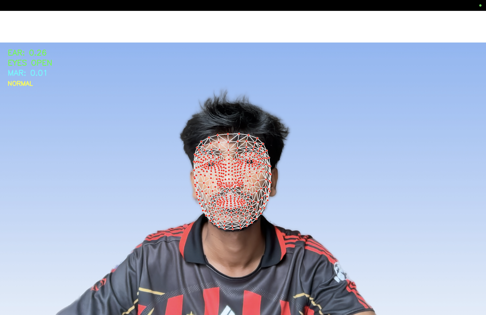

# 👁️ AI Eye & Drowsiness Monitoring System

A real-time AI-powered monitoring system that detects
driver drowsiness and yawning using computer vision.

The system monitors eye closure and mouth movements
through a webcam and triggers an audio alert when
signs of drowsiness are detected.

## 📸 Project Screenshot



## 🚀 Features

- Real-time face detection and tracking
- Eye tracking using Eye Aspect Ratio (EAR)
- Drowsiness detection based on eye closure duration
- Yawning detection using Mouth Aspect Ratio (MAR)
- Automatic audio warning system
- Live EAR and MAR measurements
- Face landmark visualization
- Automatic alarm reset when no face is detected
- Press Q to exit

## 🛠️ Technologies Used

- Python 3.11
- OpenCV
- MediaPipe Face Mesh
- NumPy
- Pygame

## ⚙️ How It Works

### 1. Face Detection
MediaPipe Face Mesh identifies facial landmarks
using the webcam.

### 2. Eye Tracking
The system calculates the Eye Aspect Ratio (EAR).

If EAR falls below 0.20 for 2 seconds,
the system displays:

DROWSINESS ALERT!

An audio alarm is activated.

### 3. Yawning Detection
The system calculates the Mouth Aspect Ratio (MAR).

If MAR exceeds 0.50 for 1.5 seconds,
the system displays:

YAWNING DETECTED!

An audio alarm is activated.

### 4. Audio Alert
Pygame generates an audio warning when
drowsiness or yawning is detected.

The alarm stops when the warning condition clears.

## 💻 Installation

### 1. Clone the Repository

```bash
git clone <your-repository-url>
cd AI_Eye_Monitoring
```

### 2. Create a Virtual Environment

```bash
python3.11 -m venv .venv
```

### 3. Activate the Virtual Environment

On macOS/Linux:

```bash
source .venv/bin/activate
```

### 4. Install Dependencies

```bash
pip install opencv-python mediapipe==0.10.21 numpy pygame
```

### 5. Run the Project

```bash
python face_mesh_test.py
```

## 🎮 Controls

| Action | Control |
|--------|---------|
| Start monitoring | Run Python script |
| Stop monitoring | Press Q |
| Drowsiness alert | Automatic |
| Yawning alert | Automatic |

## 📂 Project Structure

```text
AI_Eye_Monitoring/
│
├── face_mesh_test.py
├── camera_test.py
├── README.md
└── .venv/
```

Note: The virtual environment should not be uploaded to GitHub.

## 📊 Detection Thresholds

| Parameter | Threshold |
|-----------|-----------|
| Eye Aspect Ratio | Below 0.20 |
| Eye Closure Duration | 2 seconds |
| Mouth Aspect Ratio | Above 0.50 |
| Yawning Duration | 1.5 seconds |

## ⚠️ Limitations

- Requires a working webcam.
- Performance depends on lighting conditions.
- Face tracking may be affected by camera angles.
- Detection thresholds may require individual calibration.
- This is a prototype and not a certified driver safety system.

## 🔮 Future Enhancements

- AI-based fatigue prediction
- Mobile application integration
- Driver monitoring dashboard
- Drowsiness event history
- Advanced alert mechanisms

## 👨‍💻 Developer

**Abhishek Krishna S**

BE Computer Science and Engineering

GitHub: https://github.com/Abhsk7

## 📄 Project Status

Core features implemented and tested successfully.